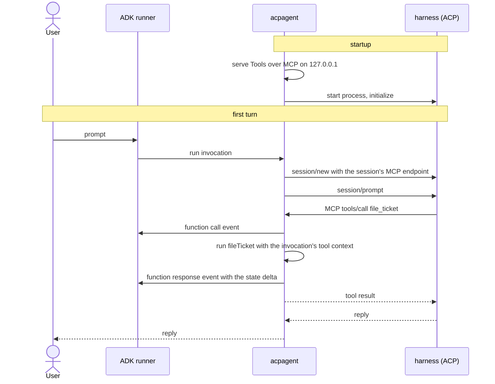

# Give a coding agent harness a tool written in Go

This sample runs a coding agent harness, such as `opencode acp`, as an ADK agent
through the experimental `exp/acpagent` package, and gives the harness a
`file_ticket` tool implemented as an ordinary `functiontool`. The harness uses
its own model and its own file tools; the Go tool runs inside the ADK session,
so what it writes to the session state is saved like the result of any other
tool.

- **Concept:** `acpagent.Config.Tools`, served to the harness over MCP
- **Needs LLM?** Yes, the harness's own model
- **Needs a harness?** Yes, any program speaking the Agent Client Protocol that
  supports HTTP MCP servers

## Goal

Show that a harness you don't control can call code you wrote in Go, with the
call and its state changes recorded in the ADK session.

## Requirements

An ACP harness on `PATH`, signed in to its model provider: `opencode acp` by
default, or another command set in `ACP_COMMAND`, for example
`gemini --experimental-acp`.

## How it works



1. `acpagent.New` starts an MCP server on a loopback port and the harness
   process.
2. When an ADK session first talks to the harness, the agent creates an ACP
   session and passes it an MCP endpoint of its own, named `adk`.
3. When the harness calls `file_ticket`, the agent runs it in the ADK
   invocation in progress for that session, and yields the call and response
   as the invocation's events before the harness gets the result.

## Running the sample

```bash
go run ./examples/acpagent/ console
```

| Variable | Required | Meaning |
|---|---|---|
| `ACP_COMMAND` | no | The harness command line, split on spaces. Defaults to `opencode acp`. |

The harness works in the current directory. It may read and search without
asking. Kind `other` is allowed too, so that a harness which asks before
calling an MCP tool does not stop at `file_ticket`. Anything else, such as
editing a file, is asked of you: the console shows the question, and your next
message answers it.

## Example session

Real output with `ACP_COMMAND="cloudcode acp"`, an opencode fork, run from the
repository root. The harness's model decides what to read and what to file, so
your output will differ.

The prompt was piped in, so the console does not echo it after `User ->`.

```text
$ printf 'Read exp/acpagent/tools.go and file one ticket with file_ticket for the most important limitation you find. Reply with the ticket ID and title only.\n' \
    | ACP_COMMAND="cloudcode acp" go run ./examples/acpagent/ console


User -> 
Agent -> I'll read the file and look up the `file_ticket` tool.

T-1: acpagent: harness tool calls bypass tool callbacks, plugins and confirmation
User -> 
EOF detected, exiting...
```

`T-1` comes from `fileTicket`, which numbers tickets by the count already in
the session state: the harness's model had no other way to get it.

## Notes

- **Tool callbacks, plugins and tool confirmation don't apply.** The harness
  decides when to call a tool, so nothing runs around the call except the tool
  itself.
- **The harness must reach `127.0.0.1`.** A harness started with
  `acpagent.Config.Start`, for example in a sandbox, needs the host's loopback
  interface.
