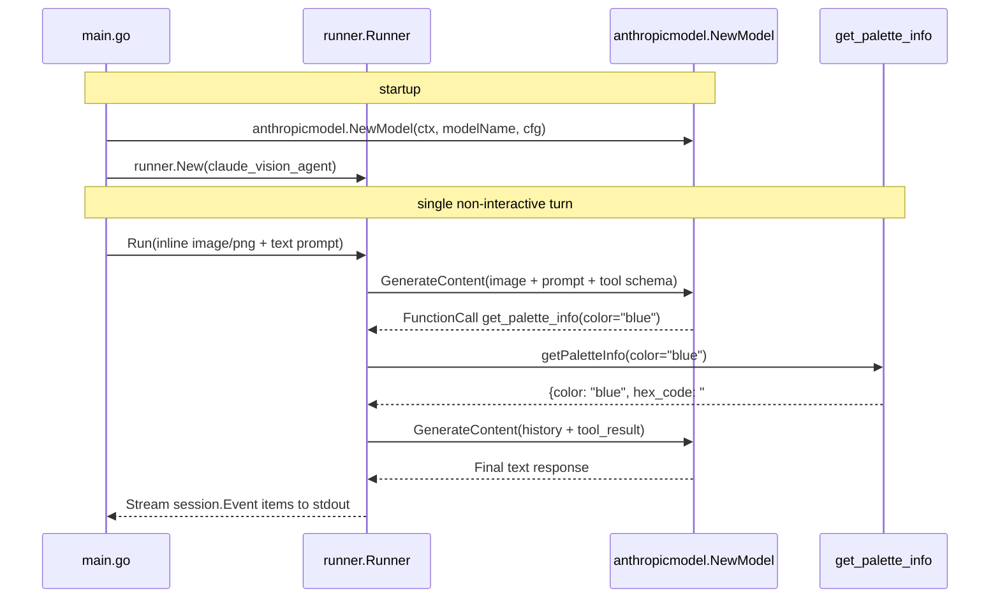

# Anthropic Claude on Vertex AI and the Anthropic API

Runs a non-interactive ADK `llmagent` backed by **Anthropic Claude** using `google.golang.org/adk/v2/model/anthropicmodel`. In a single turn, the sample sends an inline PNG image and a text prompt, invokes a Go `functiontool` (`get_palette_info`), and prints the final answer. The same agent code runs against either **Claude on Vertex AI** (Agent Platform / Model Garden) or the first-party **Anthropic Messages API**.

- **Concept:** Construct a Claude `model.LLM` with `anthropicmodel.NewModel(ctx, modelName, cfg)` for either `BackendVertex` or `BackendAnthropic` and pass it to `llmagent.New`.
- **Needs LLM?** Yes (Claude on Vertex AI or the Anthropic API)
- **Needs a deployed service?** Yes (a Google Cloud project with Vertex AI Claude access, or an Anthropic API key)

## Goal

Show that an ADK agent can combine multimodal image input and function tool calling on Claude across both serving backends without changing agent, tool, or runner code:

```go
llm, err := anthropicmodel.NewModel(ctx, "claude-sonnet-4-5-20250929", anthropicmodel.ClientConfig{
    Backend:  anthropicmodel.BackendVertex,
    Project:  os.Getenv("GOOGLE_CLOUD_PROJECT"),
    Location: os.Getenv("GOOGLE_CLOUD_LOCATION"),
})
```

## Requirements

- **For Vertex AI (`BackendVertex`):**
  1. A Google Cloud project with the Vertex AI API enabled and access to Claude in Vertex AI Model Garden.
  2. Application Default Credentials configured locally:
     ```bash
     gcloud auth application-default login
     ```
- **For the Anthropic API (`BackendAnthropic`):**
  1. An Anthropic API key (`ANTHROPIC_API_KEY`).

## How it works



1. `resolveClientConfig` selects `BackendVertex` when `GOOGLE_CLOUD_PROJECT` and `GOOGLE_CLOUD_LOCATION` are set (or `ANTHROPIC_BACKEND=vertex`), or `BackendAnthropic` when `ANTHROPIC_API_KEY` is set (or `ANTHROPIC_BACKEND=anthropic`).
2. `anthropicmodel.NewModel` creates the `model.LLM` instance for `claude-sonnet-4-5-20250929`.
3. `functiontool.New` wraps `getPaletteInfo` as the `get_palette_info` tool.
4. `runner.Runner.Run` sends the embedded 1x1 blue PNG image (`genai.NewPartFromBytes`) alongside the question, executes the `get_palette_info` tool call requested by Claude, and prints the final answer.

## Running the sample

Against **Claude on Vertex AI**:

```bash
export GOOGLE_CLOUD_PROJECT=my-project
export GOOGLE_CLOUD_LOCATION=us-east5
go run ./examples/anthropic
```

Against the **Anthropic API**:

```bash
export ANTHROPIC_API_KEY=sk-ant-...
go run ./examples/anthropic
```

| Variable | Required | Meaning |
|---|---|---|
| `GOOGLE_CLOUD_PROJECT` | Yes (for Vertex AI) | Google Cloud project ID used by `BackendVertex`. |
| `GOOGLE_CLOUD_LOCATION` | Yes (for Vertex AI) | Vertex AI region serving Claude (for example, `us-east5` or `global`). |
| `ANTHROPIC_API_KEY` | Yes (for Anthropic API) | Anthropic API key used by `BackendAnthropic`. |
| `ANTHROPIC_BACKEND` | No | Explicitly selects `"vertex"` or `"anthropic"` when both credential sets are present in the environment. |
| `ANTHROPIC_MODEL` | No | Overrides the Claude model ID (defaults to `claude-sonnet-4-5-20250929`). |

## Example session

Output from running the sample with `claude-sonnet-4-5-20250929` (the final sentence wording varies slightly across runs):

```text
$ go run ./examples/anthropic
Backend: vertex (claude-sonnet-4-5-20250929)
User -> [inline image/png, 73 bytes] What color is the attached image? Use get_palette_info to report its hex code and color family.
Tool Call -> get_palette_info(map[color:blue])
Tool Result -> get_palette_info: map[color:blue family:cool primary hex_code:#0055FF]
Agent -> The attached image is blue. According to `get_palette_info`, its canonical hex code is **#0055FF** and it belongs to the **cool primary** color family.
```

## Notes

- **Use a versioned model ID on Vertex AI.** Vertex AI does not serve `-latest` aliases, so always pass an explicit versioned ID such as `claude-sonnet-4-5-20250929` (or a full `projects/<project>/locations/<location>/publishers/anthropic/models/<model>` resource name).
- **Image URLs require `BackendAnthropic`.** Claude on Vertex AI accepts inline image and PDF bytes (`genai.NewPartFromBytes`), whereas `https://` image and PDF URLs (`genai.NewPartFromURI`) are supported only on `BackendAnthropic`.
