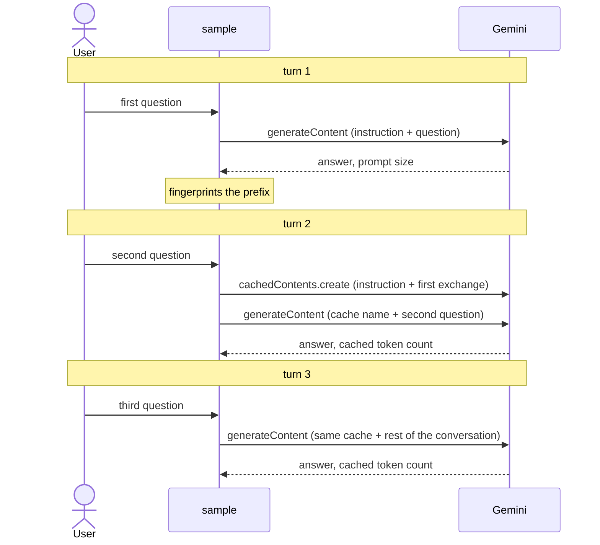

# Serve an agent's fixed prompt prefix from a Gemini cache

This sample runs three turns of a support agent whose instruction carries a
handbook of several thousand tokens. With context caching on, the runner stores
that prefix as a Gemini cache once, and later turns name the cache instead of
resending it. Each turn prints how much of its prompt the cache served.

- **Concept:** `runner.Config.ContextCache`
- **Needs LLM?** Yes (Gemini)

## Goal

Show that caching starts on its own once the prefix proves stable, and that the
tokens it serves are visible in the usage the model reports. Nothing in the
agent changes: the runner and the Gemini model create, reuse and replace the
cache.

## How it works



1. The first turn is sent whole. The runner records a fingerprint of its prefix
   (the instruction, the tools, and the conversation before the question) and
   the prompt size the model reported. No cache is created yet, because one is
   worth creating only once a second request shows the prefix is stable.
2. The second turn finds the same prefix, so it creates a cache holding the
   instruction and the first exchange, and sends only the cache name and the
   new question.
3. The third turn reuses that cache and sends the conversation that follows it.
   A cache is replaced once it expires, after `CacheIntervals` invocations, or
   as soon as the prefix changes.

The launcher has no `ContextCache` setting yet, so the sample drives
`runner.Runner` directly.

## Running the sample

```bash
export GOOGLE_API_KEY=your-key

go run ./examples/contextcache/
```

| Variable or flag | Required | Meaning |
|---|---|---|
| `GOOGLE_API_KEY` | yes | Gemini API key |
| `-model` | no | Gemini model to call. Defaults to `gemini-3.5-flash`. A prefix must reach 2048 tokens on Gemini 2.5 and 4096 on Gemini 3 before it is cached, and the handbook clears both. |

## Example session

Real output from a free-tier Gemini API key on `gemini-3.5-flash`. The free tier
allows no explicit caches, so the cache that turns 2 and 3 try to create is
refused, and each turn is sent whole. The answers do not depend on the cache.
With a billing-enabled key, turns 2 and 3 instead report most of their prompt
as served from the cache.

```text
$ go run ./examples/contextcache/
> What is the refund window for hardware orders?
Hardware orders can be refunded within 30 days of delivery.
[turn 1: prompt 5675 tokens, 0 from cache, no cache yet, prefix fingerprinted]

> And for software licenses?
Software licenses can be refunded within 14 days of purchase if the license key has not been activated.
[turn 2: prompt 5780 tokens, 0 from cache, no cache yet, prefix fingerprinted]

> Who approves a refund above the standard limit?
Refunds above the standard limit need approval from the support lead on duty.
[turn 3: prompt 5896 tokens, 0 from cache, no cache yet, prefix fingerprinted]
```

## Notes

- **Explicit caching needs a billing-enabled key.** On the free tier the API
  refuses every cache with `429 RESOURCE_EXHAUSTED`
  (`TotalCachedContentStorageTokensPerModelFreeTier ... limit=0`). The runner
  then sends each request uncached, which is why the session above never
  reports cached tokens.

- **A cache is billed while it lives.** The sample sets a five-minute TTL so
  the cache it creates does not linger.
- **Caching across turns needs a session service that keeps the cache state.**
  The in-memory, database and Vertex AI services do; see the `ContextCache`
  documentation on `runner.Config`.
