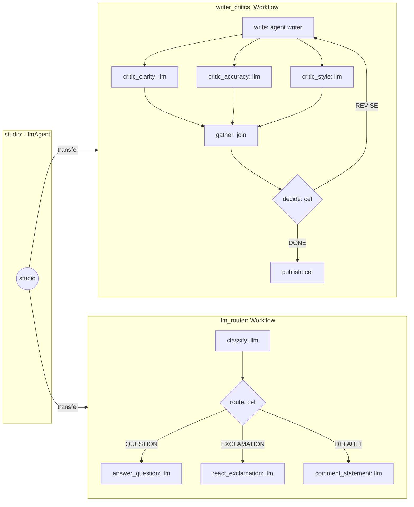
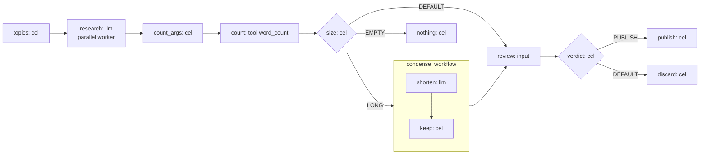

# Declare a multi-agent system in YAML, with CEL for the glue

This sample builds a root agent and two workflow sub-agents from one YAML
document, [`agent-system.yaml`](agent-system.yaml). The routing, the revision
loop and the data passed between nodes are
[CEL](https://cel.dev) expressions in that document. The Go code registers a
model and a tool, and serves what the document declares. A second document,
[`briefing.yaml`](briefing.yaml), uses the remaining node types: a parallel
worker, a tool, a nested workflow and a pause for a human.

- **Concept:** a declarative `AgentSystem` document, built into `llmagent` and
  `workflowagent` agents by a small loader that lives in this sample
- **Needs LLM?** Yes (Gemini, or any OpenAI-compatible endpoint with tool
  calls, such as Ollama)

## Goal

Show that the glue between agents can be data. Branch on a classifier's label,
loop a writer until three critics approve, reshape a join's output into the
writer's next prompt, and update session state. None of that needs a custom
Go node. Today the same graphs need code like `examples/workflow/routing/llm`,
which defines a custom node just to set `Routes`.

The loader in [`system.go`](system.go) and [`cel.go`](cel.go) is part of the
example, not an ADK API. It covers two agent classes and seven node types:

| `agent_class` | Built with |
|---|---|
| `LlmAgent` | `llmagent.New`; `sub_agents` are transfer targets, `tools` are registered tools |
| `Workflow` | `workflowagent.New` over `nodes` and `edges` |

| Node `type` | Built with | Output |
|---|---|---|
| `agent` | `workflow.NewAgentNode` around a declared agent | the agent's reply |
| `llm` | a single-turn `llmagent` named after the node, with optional `tools` | the model's reply |
| `cel` | `workflow.NewFunctionNode` | `output`, or the node's input when omitted |
| `join` | `workflow.NewJoinNode` | a map from predecessor name to its output: the node id, or the agent's name for an `agent` node |
| `tool` | `workflow.NewNamedToolNode` around a registered tool; the input is its arguments | the tool's result |
| `workflow` | `workflow.NewWorkflowNode` over its own `nodes` and `edges` | the output of its last node |
| `input` | `workflow.NewRequestInputEvent` with `message`, a CEL string | the user's reply, on the next turn |

Four more fields tune how a node runs. Their names and units are adk-python's:

| Field | Applies to | Meaning |
|---|---|---|
| `parallel_worker: true` | any node but a `join` or an `input` | `workflow.NewParallelWorker`: the input is a list, the node runs once per item, and the output is the list of results |
| `max_parallel_workers` | a parallel worker | how many items run at once; unset is no limit |
| `retry_config` | `agent`, `llm` and `tool` nodes | `max_attempts`, `initial_delay`, `max_delay`, `backoff_factor` and `jitter`, each defaulting to `workflow.DefaultRetryConfig`, so `retry_config: {}` is five attempts; on a parallel worker, for each item |
| `timeout` | `agent`, `llm` and `tool` nodes | seconds, as `initial_delay` and `max_delay` are; on a parallel worker, for all the items together |

A field set on a node type that does not read it is a validation issue, not
ignored.

Edges name nodes by id in `from_node` and `to_node`, with an optional `route`:
a route name, or a list of names any of which takes the edge.
`START` is the workflow entry. A `DEFAULT` edge fires
when none of the source node's routed edges matched.

A document names models and tools; it cannot declare them. The host passes
`loadSystem` a `registry` of both, and a name that is not in it is a
validation issue.

What a document cannot say: a `workflow.NewDynamicNode`, whose body is a Go
function; callbacks, for the same reason; node input and output schemas; and a
workflow-wide concurrency limit, which `workflowagent.Config` does not take.

## How it works



1. `loadSystem` decodes the document strictly: an unknown field is an error.
2. It validates the whole document and reports every problem at once, each
   with its field path: names, model and tool references, agent and node
   references, edge routes that no `cel` node emits, fields a node type does
   not read, numbers out of range, and CEL that does not compile or reads a
   `vars.x` declared after it.
3. It builds each agent once, root first, and `main` serves them all through
   `agent.NewMultiLoader`, so ADK Web lists `writer_critics` and `llm_router`
   as well as `studio`.
4. When a `cel` node runs, it evaluates its `vars` in order, takes the first
   `routes` entry whose `when` is true, then evaluates `output` and
   `state_delta`. Every expression sees the state as it was before the node
   ran.

A CEL expression can read these variables:

| Variable | Value |
|---|---|
| `state` | session state, such as `state.draft` written by the writer's `output_key` |
| `input` | the node's input: its predecessor's output |
| `vars` | the node's `vars` evaluated so far |
| `user` | `{content}`, the text of the user's message |
| `session` | `{id, app_name, user_id}` |
| `invocation` | `{id, agent_name}` |

The environment adds the cel-go
[extensions](https://pkg.go.dev/github.com/google/cel-go/ext) for strings,
lists, math, sets, encoders and bindings, plus optional types, so
`state.?turn_invocation.orValue('')` reads a key that may not be set yet.

## Running the sample

```bash
export GOOGLE_API_KEY=your-key

go run ./examples/declarative/ console
```

Without `GOOGLE_API_KEY`, the model registered as `default` is any
OpenAI-compatible endpoint. The model must support tool calls, because
`studio` transfers through `transfer_to_agent`. For a local Ollama server:

```bash
export OPENAI_BASE_URL=http://localhost:11434/v1 OPENAI_API_KEY=ollama
export OPENAI_MODEL=glm-5.3-flash:cloud

go run ./examples/declarative/ console
```

| Variable | Required | Meaning |
|---|---|---|
| `GOOGLE_API_KEY` | one of these | Gemini API key; runs `gemini-flash-latest` |
| `OPENAI_API_KEY`, `OPENAI_BASE_URL` | one of these | OpenAI-compatible endpoint, used when `GOOGLE_API_KEY` is unset |
| `OPENAI_MODEL` | with `OPENAI_*` | model name at that endpoint |
| `AGENT_SYSTEM` | no | path of a document to run instead of the embedded `agent-system.yaml`, such as `briefing.yaml` |

Ask `studio` to write something, such as *Write a paragraph about the history
of the bicycle*, to run `writer_critics`. Anything else, such as *Is it
raining?*, goes to `llm_router`.

## Example sessions

Two runs against `glm-5.3-flash:cloud` through Ollama, with
`-streaming_mode none`. The console prints every agent's text, so the writer's
draft and each critic's verdict appear before the final draft; they are cut to
`…` here.

```text
User -> Write a short paragraph about the history of the bicycle.
Agent -> The bicycle's history began in 1817 when German inventor Karl von Drais … APPROVEAPPROVEAPPROVE

All major claims check out: … No factual errors or overstatements detected.Final draft after 1 turn(s), 3/3 approvals:

The bicycle's history began in 1817 when German inventor Karl von Drais introduced the "running machine," … a global pastime that endures today.
```

```text
User -> I just won the marathon!
Agent -> exclamationCongratulations—that's an incredible achievement, and you must be feeling absolutely exhilarated!
```

`exclamation` is the `classify` node's output; `route` sent the message to
`react_exclamation`. `TestStudioEndToEnd` replays traffic recorded from the
same model for the bicycle prompt and one prompt per router branch, so
`go test` checks these paths offline.

A document with a typo in a CEL expression and in an edge route. This output
comes from `AGENT_SYSTEM` pointed at a copy of `agent-system.yaml` with those
two edits. Validation runs before any model call, so the output is exactly
this.

```text
$ AGENT_SYSTEM=broken.yaml go run ./examples/declarative/ console
Failed to load agent system: invalid agent system:
  agents[1].nodes[5].vars[2].expr: vars.approvd is not declared before this expression
  agents[1].edges[9].route: node "decide" never emits route "REVISED"
exit status 1
```

Both mistakes are reported in one run, each at the field to fix, before any
agent exists.

## The other node types: `briefing.yaml`

[`briefing.yaml`](briefing.yaml) is a document whose root is a workflow. It
researches a list of topics, one model call per topic, and publishes the
result once a human approves it.



```bash
AGENT_SYSTEM=examples/declarative/briefing.yaml go run ./examples/declarative/ console
```

A run against `glm-5.3-flash:cloud` through Ollama, with
`-streaming_mode none`. The three facts came to more than 40 words, so
`condense` ran, and its model reply is the first line. `review` then paused
the workflow, and `yes` resumed it.

```text
User -> bicycles, steam trains, zeppelins
Agent -> The bicycle evolved from the 1817 German draisine to the 1885 chain-driven safety bike, now used by over a billion people. Trevithick built the first working railway steam locomotive in 1804. Zeppelins carried transatlantic passengers until the 1937 Hindenburg disaster.
Agent -> Publish this briefing? (yes/no)

The bicycle evolved from the 1817 German draisine to … the 1937 Hindenburg disaster.
User -> yes
Agent -> Briefing on 3 topic(s):

The bicycle evolved from the 1817 German draisine to … the 1937 Hindenburg disaster.
```

## What it shows

- Routing on model output is a CEL `when`, not a custom node.
- A bounded loop is a routed back edge plus a counter in `state_delta`.
- A `join` hands the next node a map, which CEL reshapes into a prompt.
- A fan-out over data is a `cel` node that outputs a list and a
  `parallel_worker` after it.
- A human approval is an `input` node and a `cel` node that routes on the
  reply.

## Notes

- **A loop-back edge must be routed.** The workflow engine rejects a cycle of
  unrouted edges when the agent is built. A named route or `DEFAULT` both
  count; `decide` names `REVISE` so the YAML reads both outcomes.
- **An agent node is named after its agent, not its id.** The loader rejects
  a graph where the agent's name is also a node id, which is why node `write`
  runs agent `writer`. A parallel worker is the exception: it is named after
  its id.
- **An `llm` node sees only its input.** `route` forwards `user.content`, not
  the classifier's label, so the chosen branch answers the user's message.
- **The field names borrow from adk-python's Agent Config** (`name`,
  `agent_class`, `description`, `instruction`, `output_key`, and
  `from_node`/`to_node`/`route` edges), but the document is not a Python
  config file. One file declares every agent, so it has an
  `apiVersion`/`kind: AgentSystem` envelope and an `agents` list, and
  `sub_agents` and agent nodes name agents in it rather than other files.
  A workflow lists its `nodes` with an `id` and a `type`, because `cel`,
  `join` and `input` nodes have no Python config counterpart; Python infers
  nodes from its edges. `model` and `tools` name what the Go host registers
  rather than a model id or an import path, `mode: single_turn` sets the
  `llmagent` mode, and edges are only the explicit map form, not chains or
  routing maps. A node's `parallel_worker`, `max_parallel_workers`,
  `retry_config` and `timeout` are Python's node fields unchanged.
- **A failed evaluation names the node and field, not the cause.** cel-go's
  error text can quote the values involved, which may be the user's message
  or model output, so the loader drops it.
- **A parallel worker yields its list of results and nothing else.** No text
  is shown, and the routes, state changes and tool calls of each run are
  dropped, so the loader rejects `routes` and `state_delta` on a parallel
  `cel` node, and `tools` or an `output_key` on a parallel model call. It also
  rejects a parallel `agent` node that runs a Workflow agent, whose graph it
  does not check for those; nest the graph in a `workflow` node instead. Both
  rules cover every agent the node's agent can transfer to through
  `sub_agents`. End the graph with a `cel` node that formats the list, as
  `publish` does.
- **An `input` node's successor gets the reply, not the node's input.** The
  reply arrives on the next turn, so what the workflow asked about has to be
  in session state by then: `condense` and `count_args` write
  `state.briefing`, and `verdict` reads it back. The reply is whatever the
  client sent, not always text, so `verdict` checks its type.
- **An `input` node belongs to the top-level graph of a Workflow agent.**
  Inside a `workflow` node, or in a Workflow agent that another graph runs as
  an `agent` node or reaches through that node's `sub_agents`, the reply
  would not resume the graph that asked, so the loader rejects each. A graph
  also cannot loop
  back into an `input` node it has already paused at: the workflow engine
  does not resume the second pause.
