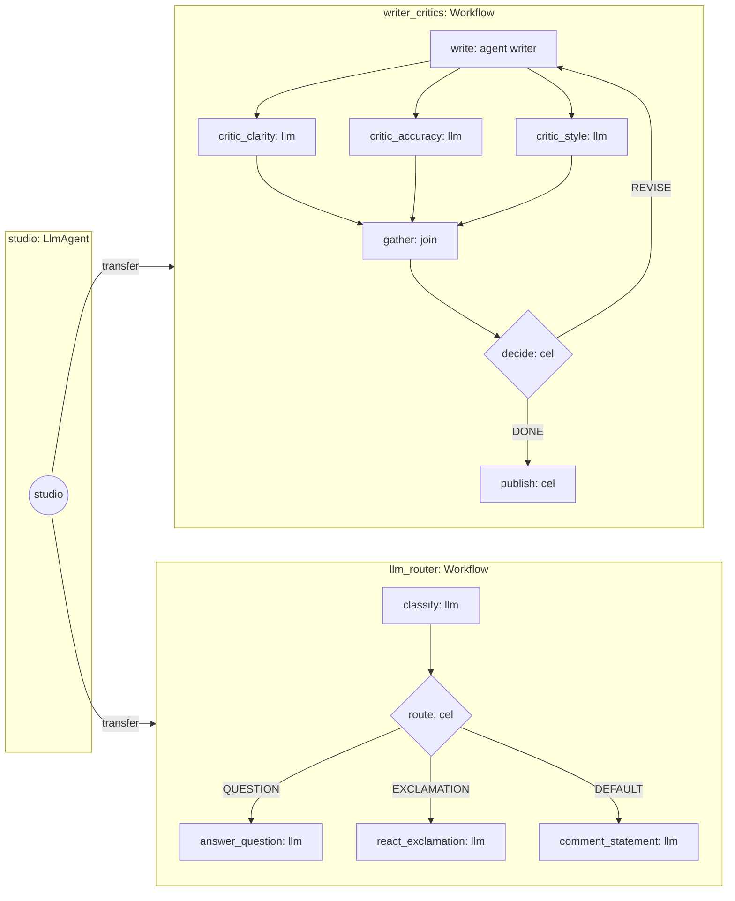

# Declare a multi-agent system in YAML, with CEL for the glue

This sample builds a root agent and two workflow sub-agents from one YAML
document, [`agent-system.yaml`](agent-system.yaml). The routing, the revision
loop and the data passed between nodes are
[CEL](https://cel.dev) expressions in that document. The Go code registers one
model and serves what the document declares.

- **Concept:** a declarative `AgentSystem` document, built into `llmagent` and
  `workflowagent` agents by a small loader that lives in this sample
- **Needs LLM?** Yes (Gemini, or any OpenAI-compatible endpoint with tool
  calls, such as Ollama)

## Goal

Show that the glue between agents can be data. Branch on a classifier's label,
loop a writer until three critics approve, reshape a join's output into the
writer's next prompt, and update session state. None of that needs a custom
Go node. Today the same graphs need code like `examples/workflow/routing/llm`,
which defines a custom node just to set `Routes`.

The loader in [`system.go`](system.go) and [`cel.go`](cel.go) is part of the
example, not an ADK API. It covers two agent classes and four node types, which
is enough for the two workflows here:

| `agent_class` | Built with |
|---|---|
| `LlmAgent` | `llmagent.New`; `sub_agents` are transfer targets |
| `Workflow` | `workflowagent.New` over `nodes` and `edges` |

| Node `type` | Built with | Output |
|---|---|---|
| `agent` | `workflow.NewAgentNode` around a declared agent | the agent's reply |
| `llm` | a single-turn `llmagent` named after the node | the model's reply |
| `cel` | `workflow.NewFunctionNode` | `output`, or the node's input when omitted |
| `join` | `workflow.NewJoinNode` | a map from predecessor id to its output |

Edges name nodes by id in `from_node` and `to_node`, with an optional `route`.
`START` is the workflow entry. A `DEFAULT` edge fires
when none of the source node's routed edges matched.

## How it works



1. `loadSystem` decodes the document strictly: an unknown field is an error.
2. It validates the whole document and reports every problem at once, each
   with its field path: names, model references, agent and node references,
   edge routes that no `cel` node emits, and CEL that does not compile or
   reads a `vars.x` declared after it.
3. It builds each agent once, root first, and `main` serves them all through
   `agent.NewMultiLoader`, so ADK Web lists `writer_critics` and `llm_router`
   as well as `studio`.
4. When a `cel` node runs, it evaluates its `vars` in order, takes the first
   `routes` entry whose `when` is true, then evaluates `output` and
   `state_delta`. Every expression sees the state as it was before the node
   ran.

A CEL expression can read these variables:

| Variable | Value |
|---|---|
| `state` | session state, such as `state.draft` written by the writer's `output_key` |
| `input` | the node's input: its predecessor's output |
| `vars` | the node's `vars` evaluated so far |
| `user` | `{content}`, the text of the user's message |
| `session` | `{id, app_name, user_id}` |
| `invocation` | `{id, agent_name}` |

The environment adds the cel-go
[extensions](https://pkg.go.dev/github.com/google/cel-go/ext) for strings,
lists, math, sets, encoders and bindings, plus optional types, so
`state.?turn_invocation.orValue('')` reads a key that may not be set yet.

## Running the sample

```bash
export GOOGLE_API_KEY=your-key

go run ./examples/declarative/ console
```

Without `GOOGLE_API_KEY`, the model registered as `default` is any
OpenAI-compatible endpoint. The model must support tool calls, because
`studio` transfers through `transfer_to_agent`. For a local Ollama server:

```bash
export OPENAI_BASE_URL=http://localhost:11434/v1 OPENAI_API_KEY=ollama
export OPENAI_MODEL=glm-5.3-flash:cloud

go run ./examples/declarative/ console
```

| Variable | Required | Meaning |
|---|---|---|
| `GOOGLE_API_KEY` | one of these | Gemini API key; runs `gemini-flash-latest` |
| `OPENAI_API_KEY`, `OPENAI_BASE_URL` | one of these | OpenAI-compatible endpoint, used when `GOOGLE_API_KEY` is unset |
| `OPENAI_MODEL` | with `OPENAI_*` | model name at that endpoint |
| `AGENT_SYSTEM` | no | path of a document to run instead of the embedded `agent-system.yaml` |

Ask `studio` to write something, such as *Write a paragraph about the history
of the bicycle*, to run `writer_critics`. Anything else, such as *Is it
raining?*, goes to `llm_router`.

## Example sessions

Two runs against `glm-5.3-flash:cloud` through Ollama, with
`-streaming_mode none`. The console prints every agent's text, so the writer's
draft and each critic's verdict appear before the final draft; they are cut to
`…` here.

```text
User -> Write a short paragraph about the history of the bicycle.
Agent -> The bicycle's history began in 1817 when German inventor Karl von Drais … APPROVEAPPROVEAPPROVE

All major claims check out: … No factual errors or overstatements detected.Final draft after 1 turn(s), 3/3 approvals:

The bicycle's history began in 1817 when German inventor Karl von Drais introduced the "running machine," … a global pastime that endures today.
```

```text
User -> I just won the marathon!
Agent -> exclamationCongratulations—that's an incredible achievement, and you must be feeling absolutely exhilarated!
```

`exclamation` is the `classify` node's output; `route` sent the message to
`react_exclamation`. `TestStudioEndToEnd` replays traffic recorded from the
same model for the bicycle prompt and one prompt per router branch, so
`go test` checks these paths offline.

A document with a typo in a CEL expression and in an edge route. This output
comes from `AGENT_SYSTEM` pointed at a copy of `agent-system.yaml` with those
two edits. Validation runs before any model call, so the output is exactly
this.

```text
$ AGENT_SYSTEM=broken.yaml go run ./examples/declarative/ console
Failed to load agent system: invalid agent system:
  agents[1].nodes[5].vars[2].expr: vars.approvd is not declared before this expression
  agents[1].edges[9].route: node "decide" never emits route "REVISED"
exit status 1
```

Both mistakes are reported in one run, each at the field to fix, before any
agent exists.

## What it shows

- Routing on model output is a CEL `when`, not a custom node.
- A bounded loop is a routed back edge plus a counter in `state_delta`.
- A `join` hands the next node a map, which CEL reshapes into a prompt.

## Notes

- **A loop-back edge must be routed.** The workflow engine rejects a cycle of
  unrouted edges when the agent is built. A named route or `DEFAULT` both
  count; `decide` names `REVISE` so the YAML reads both outcomes.
- **An agent node is named after its agent, not its id.** The loader rejects
  a graph where the agent's name is also a node id, which is why node `write`
  runs agent `writer`.
- **An `llm` node sees only its input.** `route` forwards `user.content`, not
  the classifier's label, so the chosen branch answers the user's message.
- **The field names borrow from adk-python's Agent Config** (`name`,
  `agent_class`, `description`, `instruction`, `output_key`, and
  `from_node`/`to_node`/`route` edges), but the document is not a Python
  config file. One file declares every agent, so it has an
  `apiVersion`/`kind: AgentSystem` envelope and an `agents` list, and
  `sub_agents` and agent nodes name agents in it rather than other files.
  A workflow lists its `nodes` with an `id` and a `type` (`agent`, `llm`,
  `cel`, `join`), because `cel` and `join` nodes have no Python config
  counterpart; Python infers nodes from its edges. `model` names a model the
  Go host registers rather than a model id, `mode: single_turn` sets the
  `llmagent` mode, and edges are only the explicit map form, not chains or
  routing maps.
- **A failed evaluation names the node and field, not the cause.** cel-go's
  error text can quote the values involved, which may be the user's message
  or model output, so the loader drops it.
